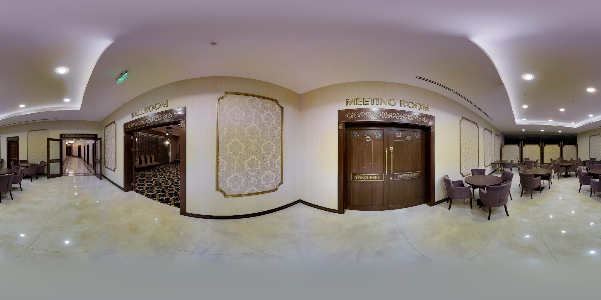
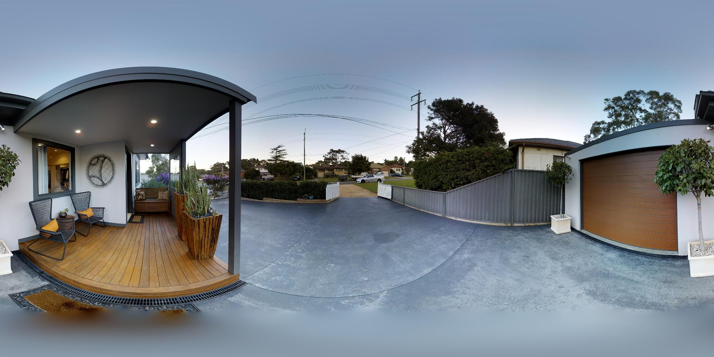
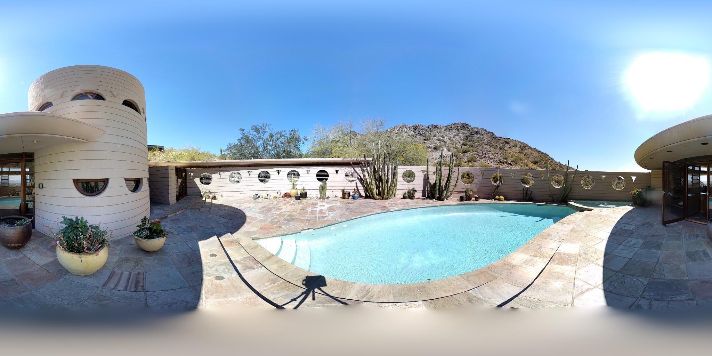
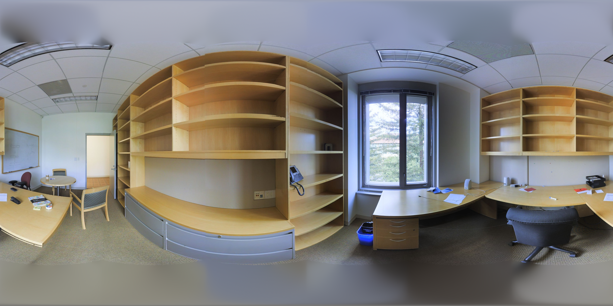

# Real panorama examples

Four real RGB equirectangular panoramas supplied by the maintainer.

Run every sample with one model load:

```bash
bash scripts/run_demo.sh --save-views
```

Results: outputs/real_samples/<image_stem>/. To select weights, add
--checkpoint /path/to/pytorch_model.bin. To run again, add --overwrite.

| Sample | Input resolution | Preview |
| --- | --- | --- |
| [0db658dc49514ca18be7b44ceb363849.jpg](0db658dc49514ca18be7b44ceb363849.jpg) | 2048 × 1024 |  |
| [8beb518ec95f4f4c89ca17861fbf1901.jpg](8beb518ec95f4f4c89ca17861fbf1901.jpg) | 2048 × 1024 |  |
| [8c77db8279a84ad382a298afaa6d6adf.jpg](8c77db8279a84ad382a298afaa6d6adf.jpg) | 2048 × 1024 |  |
| [camera_0a529ee09fc04037831902b83073862b_office_4_frame_equirectangular_domain_rgb.png](camera_0a529ee09fc04037831902b83073862b_office_4_frame_equirectangular_domain_rgb.png) | 4096 × 2048 |  |

All demo inputs are real samples. Additional supported images placed directly in
this folder are included automatically. Each panorama is reconstructed independently.

Image provenance and terms remain those of the original sources. These images
are not designated CC0 or automatically covered by the source-code license.

For an interactive selector, launch the browser demo from the repository root:

```bash
pip install -r requirements-demo.txt
python demo.py --checkpoint /path/to/pytorch_model.bin
```
